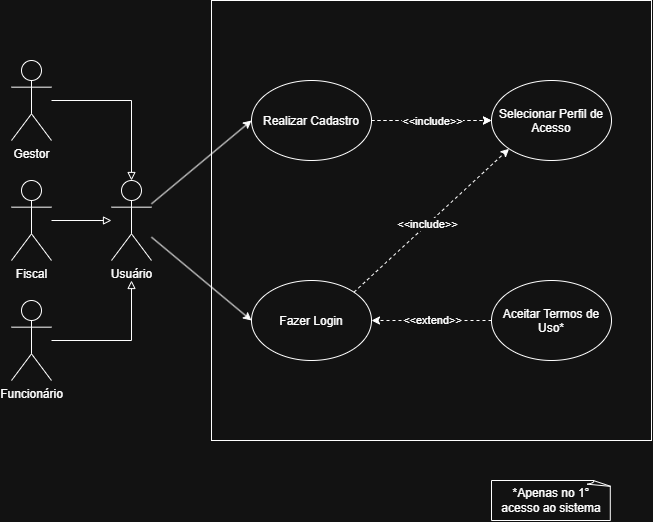

# 04 · Casos de uso

## Gerenciamento de usuários

### Atores

- **Usuário**: ator genérico. Gestor, Fiscal e Funcionário são especializações dele, então todo caso de uso do Usuário vale para os três perfis.
- **Gestor**, **Fiscal** e **Funcionário**: os três tipos de usuário (veja o [glossário](../02-glossario.md)).

### Casos de uso

| Caso de uso | Descrição | Relações |
|-------------|-----------|----------|
| Realizar Cadastro | O usuário cria a conta informando nome, CPF, e-mail, login, senha, confirmação da senha e perfil. As regras de login e senha estão em [`openspec/specs/usuarios`](../../openspec/specs/usuarios/spec.md). | `<<include>>` Selecionar Perfil de Acesso |
| Selecionar Perfil de Acesso | O usuário escolhe um dos perfis (Funcionário, Fiscal ou Gestor). | Incluído pelo cadastro e pelo login |
| Fazer Login | O usuário entra no sistema. | `<<include>>` Selecionar Perfil de Acesso |
| Aceitar Termos de Uso | O usuário aceita os Termos de Uso e a Política de Privacidade. Só é exigido no primeiro acesso ao sistema. | `<<extend>>` Fazer Login |

A listagem de usuários e a escolha do mecanismo de persistência são requisitos da spec de usuários e, nesta etapa, não têm caso de uso próprio no diagrama.
