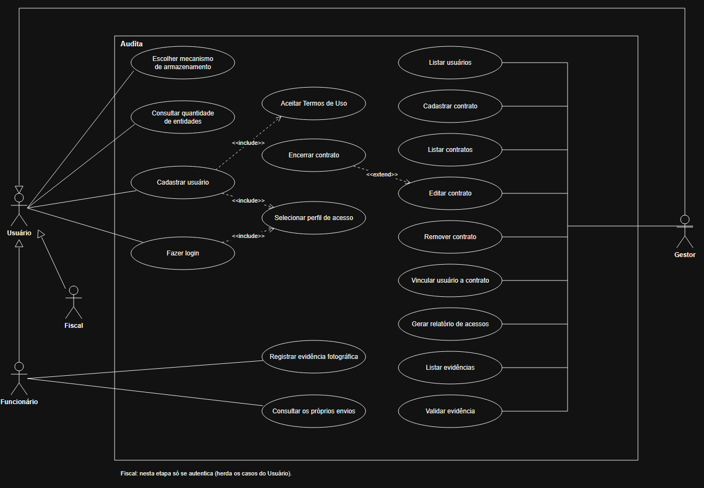

# 04 · Casos de uso

## Gerenciamento de usuários

O diagrama traz todos os casos de uso do sistema ([lista completa](casos-de-uso-completo.md)). Os casos de uso do gerenciamento de usuários são os descritos abaixo.

### Atores

- **Usuário**: ator genérico. Gestor, Fiscal e Funcionário são especializações dele, então todo caso de uso do Usuário vale para os três perfis.
- **Gestor**, **Fiscal** e **Funcionário**: os três tipos de usuário (veja o [glossário](../02-glossario.md)).

### Casos de uso

| Caso de uso | Descrição | Relações |
|-------------|-----------|----------|
| Cadastrar usuário | O usuário cria a conta informando nome, CPF, e-mail, login, senha, confirmação da senha e perfil. As regras de login e senha estão em [`openspec/specs/usuarios`](../../openspec/specs/usuarios/spec.md). | `<<include>>` Selecionar perfil de acesso e Aceitar Termos de Uso |
| Selecionar perfil de acesso | O usuário escolhe um dos perfis (Funcionário, Fiscal ou Gestor). | Incluído pelo cadastro e pelo login |
| Fazer login | O usuário entra no sistema. | `<<include>>` Selecionar perfil de acesso |
| Aceitar Termos de Uso | O usuário aceita os Termos de Uso e a Política de Privacidade. O aceite é exigido no cadastro (RF 01). | Incluído pelo cadastro |
| Listar usuários | O gestor vê os usuários cadastrados (RF 13). | |
| Escolher mecanismo de armazenamento | Ao iniciar, o usuário escolhe entre SQLite e memória (RF 14). | |
| Consultar quantidade de entidades | O usuário vê o total e a quantidade de cada tipo de entidade, sem precisar de login (RF 16). | |
