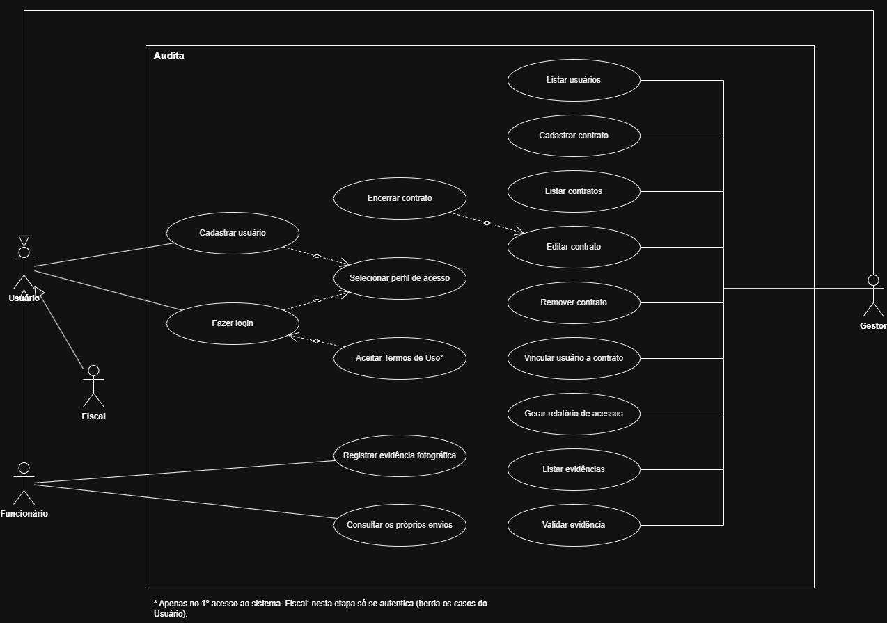
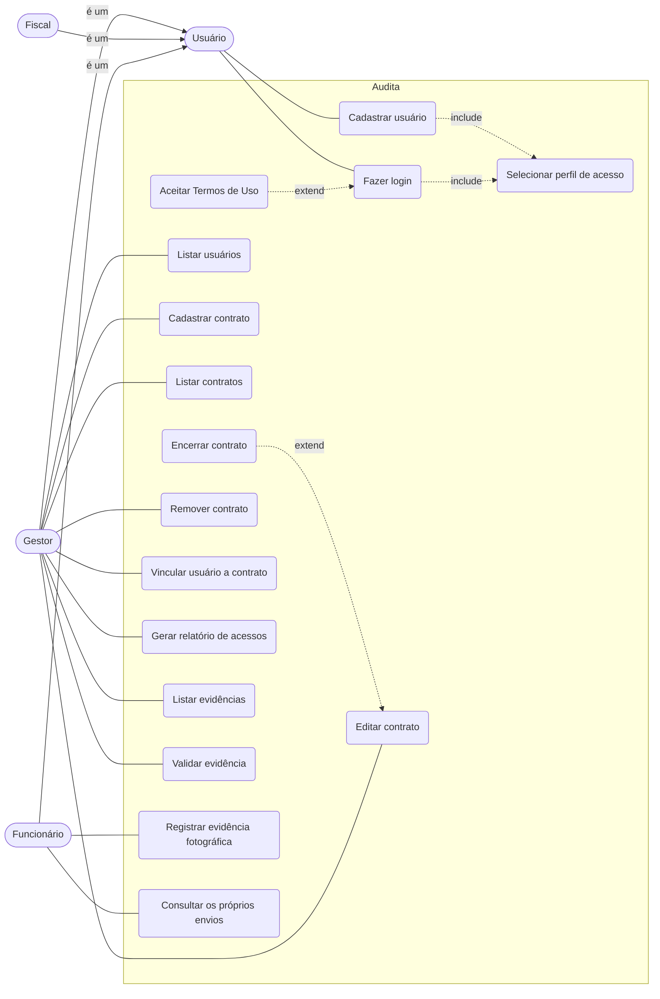

# Casos de uso do sistema (completo)

Os atores e as especializações seguem o [diagrama de usuários](README.md): Gestor, Fiscal e Funcionário são especializações de Usuário, então herdam os casos de uso dele.

## Visão para leitura no GitHub

## Casos de uso por ator

| Ator | Casos de uso | Requisitos |
|------|--------------|------------|
| Usuário (todos os perfis) | Cadastrar usuário, Fazer login, Selecionar perfil de acesso, Aceitar Termos de Uso | RF 01, RF 02 |
| Gestor | Listar usuários | RF 13 |
| Gestor | Cadastrar, listar, editar, encerrar e remover contrato; vincular usuário a contrato | RF 04 a RF 08 |
| Gestor | Listar e validar evidências | RF 10, RF 11 |
| Gestor | Gerar relatório de acessos | RF 15 |
| Funcionário | Registrar evidência fotográfica; consultar os próprios envios | RF 09, RF 12 |
| Fiscal | Nesta etapa, só os casos de uso do Usuário (a abertura de chamados é versão futura) | RF 03 |

As permissões por perfil seguem o RF 03. Os casos de uso de evidência (RF 09 a RF 12) aparecem no diagrama porque fazem parte do escopo do documento de requisitos, mas serão detalhados quando forem implementados.

## Casos de uso detalhados

- [UC01 · Cadastrar usuário](uc01-cadastrar-usuario.md)
- [UC02 · Cadastrar contrato](uc02-cadastrar-contrato.md)
- [UC03 · Vincular usuário a contrato](uc03-vincular-usuario-contrato.md)
