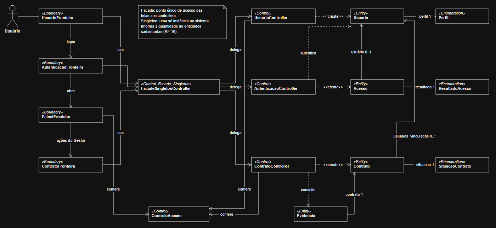
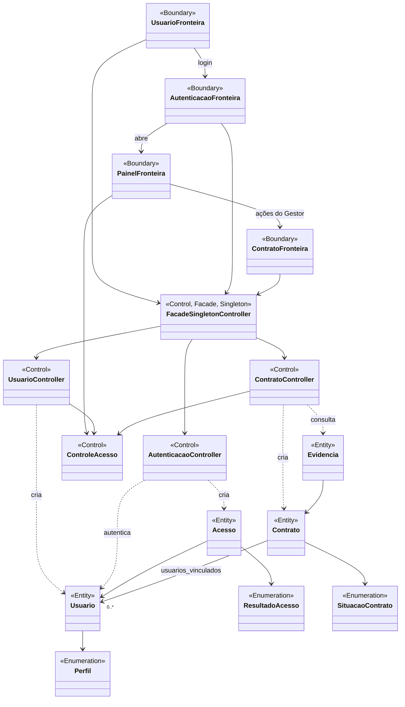

# 05 · Análise

## Diagrama de classes de análise

Considera o sistema até a Sprint 3: o CRUD de duas entidades (`Usuario` e `Contrato`) e a fachada única, com os padrões Facade e Singleton.

O diagrama de análise mostra só os nomes das classes, nos estereótipos fronteira, controle e entidade, sem atributos nem métodos. O que cada classe faz está descrito nas tabelas abaixo. Os detalhes de projeto (validadores, exceções e repositórios) estão nos [diagramas de classes de projeto](08-projeto.md#2-diagrama-de-classes-de-projeto).

## Classes por estereótipo

### Fronteira (`<<Boundary>>`)

| Classe | Responsabilidade |
|--------|------------------|
| `UsuarioFronteira` | Menu principal de console: cadastrar usuário, ver os termos, entrar, ver a quantidade de entidades e listar usuários. Lê os dados, monta o `DadosCadastroUsuario` e mostra as mensagens de sucesso e de erro. |
| `AutenticacaoFronteira` | Tela de login: lê o identificador, a senha e o perfil e, em caso de sucesso, abre o painel. |
| `PainelFronteira` | Mostra só as ações que o perfil do usuário autenticado pode executar. |
| `ContratoFronteira` | Telas de cadastrar, listar, editar, encerrar e remover contrato e de vincular e desvincular usuário. Monta o `DadosCadastroContrato`. |

### Controle (`<<Control>>`)

| Classe | Responsabilidade |
|--------|------------------|
| `FacadeSingletonController` | **Facade:** ponto único de acesso das fronteiras aos controllers. **Singleton:** uma só instância em toda a aplicação. Informa a quantidade de entidades cadastradas ([ADR 0002](adr/0002-fachada-unica.md)). |
| `UsuarioController` | Coordena o cadastro (valida, cria o `Usuario`, grava) e a listagem de usuários. |
| `AutenticacaoController` | Confere as credenciais e registra cada tentativa de login como um `Acesso`. |
| `ContratoController` | Coordena o CRUD de contratos e os vínculos com usuários. |
| `ControleAcesso` | Confere se o perfil do usuário pode executar a operação. |
| `ValidadorCadastroUsuario` e `ValidadorCadastroContrato` | Aplicam, em ordem, as regras de cada campo. |
| Validadores (`ValidadorLogin`, `ValidadorSenha`, `ValidadorCpf`, `ValidadorEmail`, `ValidadorPerfil`, `ValidadorCampoObrigatorio`, `ValidadorUnicidade`, `ValidadorNumeroContrato`, `ValidadorEmpresaContratada`, `ValidadorVigencia`, `ValidadorArquivoContrato`) | Uma regra por classe. |

### Entidade (`<<Entity>>`)

| Classe | Responsabilidade |
|--------|------------------|
| `Usuario` | Dados do usuário (id, nome, CPF, e-mail, login, hash da senha, perfil, situação e aceite dos termos). Não imprime a senha. |
| `Perfil` | Enumeração `GESTOR`, `FISCAL`, `FUNCIONARIO`. |
| `Acesso` | Registro de uma tentativa de login. |
| `ResultadoAcesso` | Enumeração `SUCESSO`, `CREDENCIAIS_INVALIDAS`, `BLOQUEADO`. |
| `Contrato` | Dados do contrato (número, empresa, vigência, arquivo e situação) e os usuários vinculados. |
| `SituacaoContrato` | Enumeração `ATIVO`, `ENCERRADO`. |
| `Evidencia` | Evidência fotográfica de um contrato. Nesta etapa, só é consultada para decidir se o contrato pode ser removido e entra na contagem de entidades. |

### Apoio

| Classe | Responsabilidade |
|--------|------------------|
| `DadosCadastroUsuario` e `DadosCadastroContrato` | DTOs que levam os campos digitados da fronteira ao controle. |

## Fluxo do cadastro de usuário

1. `UsuarioFronteira` lê os campos e cria o `DadosCadastroUsuario`.
2. A fronteira chama a fachada, que delega a `UsuarioController.adicionar`.
3. O controller normaliza os dados e chama `ValidadorCadastroUsuario.validar`.
4. Cada validador lança a exceção da sua regra (`ValidacaoError`), que a fronteira mostra sem encerrar o programa.
5. Passando em todas as regras, o controller cria o `Usuario` e o grava pelo repositório.

## Fluxo do cadastro de contrato

1. `ContratoFronteira` lê os campos e cria o `DadosCadastroContrato`.
2. A fronteira chama a fachada, que delega a `ContratoController.adicionar`.
3. O controller confere a permissão em `ControleAcesso` e valida os dados com `ValidadorCadastroContrato`.
4. Passando nas regras, o controller cria o `Contrato` com situação `ATIVO`, o grava pelo repositório e registra a operação no log de auditoria.
