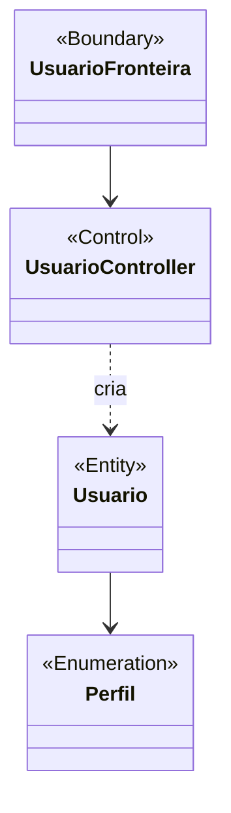

# 05 · Análise

## Diagrama de classes de análise do gerenciamento de usuários

Diagrama editável: [`classes-analise-usuarios.drawio`](diagramas/classes-analise-usuarios.drawio) (abra no [diagrams.net](https://app.diagrams.net) ou na extensão Draw.io do VS Code).

O diagrama de análise mostra só os nomes das classes, nos estereótipos fronteira, controle e entidade, sem atributos nem métodos. O que cada classe faz está descrito nas tabelas abaixo. Os detalhes de projeto (validadores, exceções e repositórios) estão no [diagrama de classes de projeto](08-projeto.md#2-diagrama-de-classes-de-projeto).

## Classes por estereótipo

### Fronteira (`<<Boundary>>`)

| Classe | Responsabilidade |
|--------|------------------|
| `UsuarioFronteira` | Menu de console: cadastrar e listar usuários. Lê os dados, monta o `DadosCadastroUsuario` e mostra as mensagens de sucesso e de erro. |

### Controle (`<<Control>>`)

| Classe | Responsabilidade |
|--------|------------------|
| `UsuarioController` | Coordena o cadastro (valida, cria o `Usuario`, grava) e a listagem. |
| `ValidadorCadastroUsuario` | Aplica, em ordem, as regras de cada campo. |
| Validadores (`ValidadorLogin`, `ValidadorSenha`, `ValidadorCpf`, `ValidadorEmail`, `ValidadorPerfil`, `ValidadorCampoObrigatorio`, `ValidadorUnicidade`) | Uma regra por classe, todos implementando `Validador`. |

### Entidade (`<<Entity>>`)

| Classe | Responsabilidade |
|--------|------------------|
| `Usuario` | Dados do usuário (id, nome, CPF, e-mail, login, senha, perfil e situação). Não imprime a senha. |
| `Perfil` | Enumeração `GESTOR`, `FISCAL`, `FUNCIONARIO`. |

### Apoio

| Classe | Responsabilidade |
|--------|------------------|
| `DadosCadastroUsuario` | DTO que leva os campos digitados da fronteira ao controle. |

## Fluxo do cadastro

1. `UsuarioFronteira` lê os campos e cria o `DadosCadastroUsuario`.
2. `UsuarioController.adicionar` normaliza os dados e chama `ValidadorCadastroUsuario.validar`.
3. Cada validador lança a exceção da sua regra (`ValidacaoError`), que a fronteira mostra sem encerrar o programa.
4. Passando em todas as regras, o controller cria o `Usuario` e o grava pelo repositório.
