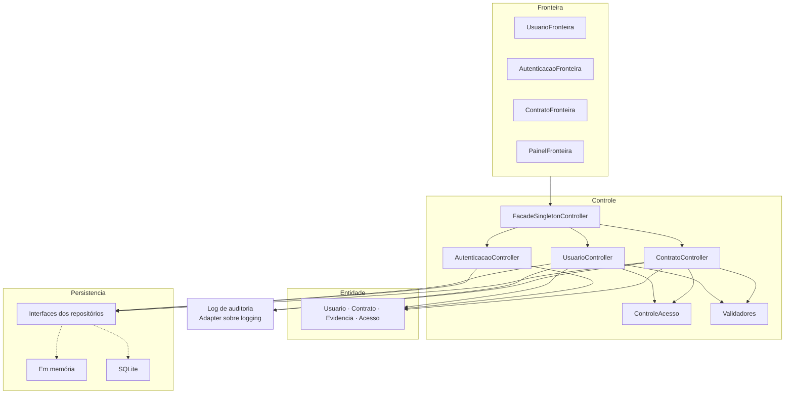
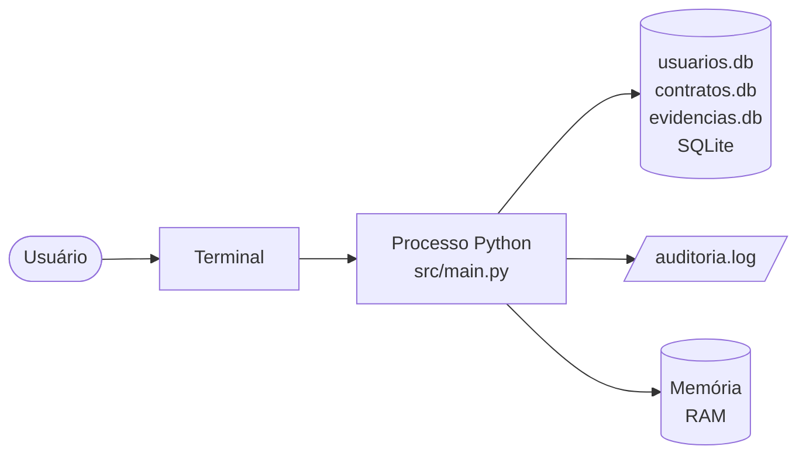

# 07 · Arquitetura

## Arquitetura lógica

O Audita é uma aplicação em camadas. A dependência vai sempre de cima para baixo; a camada de persistência é acessada por interfaces.

| Camada | Responsabilidade | Pacote |
|--------|------------------|--------|
| Fronteira | Telas de console e painel por perfil | `fronteira/` |
| Controle | Regras de negócio, validação, controle de acesso e a fachada | `controle/` |
| Entidade | Dados do domínio | `entidade/` |
| Persistência | Repositórios (interface, memória e SQLite) | `persistencia/` |
| Exceção | Exceções de validação, de acesso e de persistência | `excecao/` |
| Log | Interface do log de auditoria e seu adaptador | `log/` |

**Raiz de composição:** `main.py` é o único lugar que escolhe as implementações (memória ou SQLite) e monta os controllers, a fachada e as telas.

## Arquitetura física

Nesta etapa o Audita é um **único processo Python** na máquina do usuário, com interface de console. Não há servidor, rede nem cliente separado.

| Elemento | Descrição |
|----------|-----------|
| Terminal | Entrada e saída por menus numerados |
| Processo Python | Toda a aplicação, em Python 3.10 ou superior |
| `usuarios.db` | Arquivo SQLite com os usuários e os acessos (se o SQLite for escolhido) |
| `contratos.db` | Arquivo SQLite com os contratos e os vínculos (se o SQLite for escolhido) |
| `evidencias.db` | Arquivo SQLite com as evidências (se o SQLite for escolhido) |
| `auditoria.log` | Arquivo do log de auditoria (se o SQLite for escolhido) |
| Memória | Mecanismo alternativo; os dados somem ao encerrar |

A plataforma mobile e web do produto completo, e os serviços externos (IA, armazenamento em nuvem, notificações), não fazem parte desta etapa.

## Como cada requisito não funcional é atendido

Numeração do documento de requisitos, por categoria.

### Usabilidade

| Requisito | Como é atendido | Situação |
|-----------|-----------------|----------|
| NF001 · Mensagens de validação com campo e regra | Cada regra tem sua exceção, com mensagem que cita o campo e a regra; a fronteira só exibe a mensagem | Atendido (RF 01 e RF 04) |
| NF002 · Registrar evidência em até 5 toques | Depende do RF 09 | Versão futura |

### Confiabilidade

| Requisito | Como é atendido | Situação |
|-----------|-----------------|----------|
| NF001 · Persistência dos dados | Repositórios atrás de interface, com os mecanismos em memória e SQLite escolhidos no início (ADR 0001); falhas de E/S viram `PersistenciaError`, tratadas na fronteira | Atendido |
| NF002 · Envio de evidência sem dados pela metade | Depende do RF 09 | Versão futura |
| NF003 · Backup e recuperação | Fora do escopo desta etapa | Versão futura |

### Desempenho

| Requisito | Como é atendido | Situação |
|-----------|-----------------|----------|
| NF001 · Resposta em até 1 s no volume de referência | Operações sobre listas curtas (até 100 usuários e 50 contratos), com paginação de 20 itens e consultas por chave única indexada no SQLite | Atendido; verificado por `tests/test_desempenho.py` (100 usuários e 50 contratos, 100 execuções de cada operação, nos dois mecanismos) |
| NF002 · Tempo de envio da foto | Depende do RF 09 | Versão futura |
| NF003 · Usuários simultâneos | A aplicação é de console, com um usuário por vez | Versão futura |

### Segurança

| Requisito | Como é atendido | Situação |
|-----------|-----------------|----------|
| NF001 · Autenticação segura | Senha só como hash Argon2id (`HashSenhaArgon2`), com salt por senha; senha conferida mesmo quando o usuário não existe | Atendido |
| NF002 · Comunicação criptografada | Não há tráfego de rede nesta etapa | Versão futura |
| NF003 · Controle de acesso no servidor | `ControleAcesso` conferido nos controllers, com a matriz perfil × operação (`PERMISSOES_PADRAO`), e não só no menu; sem login, tudo é negado | Atendido |
| NF004 · Log de auditoria imutável | `LogAuditoria` só tem `registrar` e `listar`; `RegistroLog` é imutável (`frozen`); escrita com `flush` imediato; data e hora em dd/mm/aaaa hh:mm:ss | Atendido |

### Adequação a padrões

| Requisito | Como é atendido | Situação |
|-----------|-----------------|----------|
| NF001 · LGPD | Cada requisito de proteção de dados cita o artigo de origem; veja NF002 a NF006 | Atendido |
| NF002 · Coleta mínima e máscara do CPF | O cadastro pede só nome, CPF, e-mail, login e senha; o CPF fica fora das listagens e sai mascarado (`XXX.456.789-XX`) | Atendido |
| NF003 · Informação ao titular | Termos de Uso e Política de Privacidade na opção 2 do menu, com resumo antes do aceite; o aceite é gravado com data e hora | Atendido |
| NF004 · Direitos do titular | Fora do escopo desta etapa | Versão futura |
| NF005 · Conservação dos registros de auditoria | Fora do escopo desta etapa | Versão futura |
| NF006 · Formato de datas e horários | Módulo `utils/datas` com dd/mm/aaaa e hh:mm no fuso de Brasília | Atendido (listagem de contratos e relatório) |
