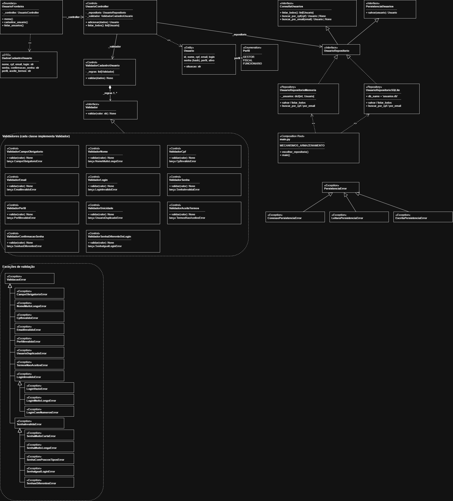
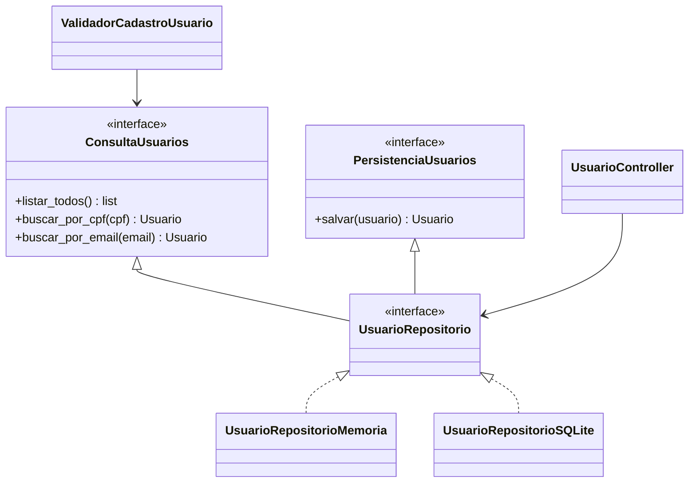
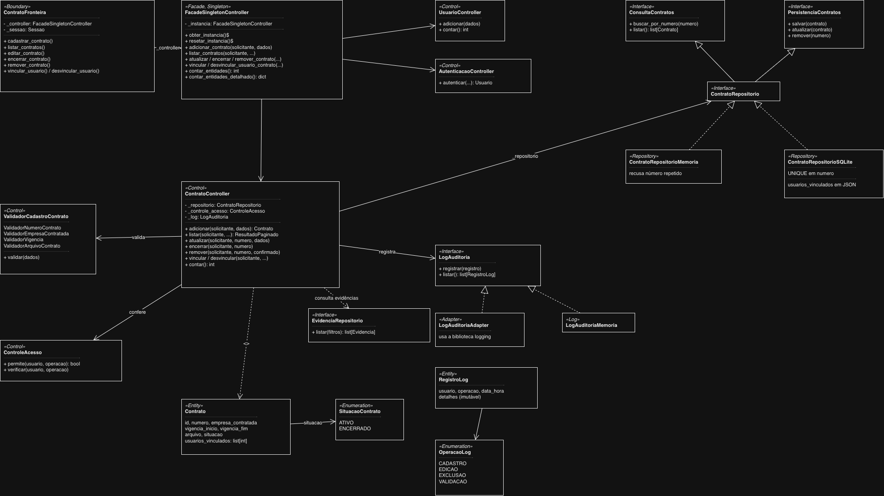
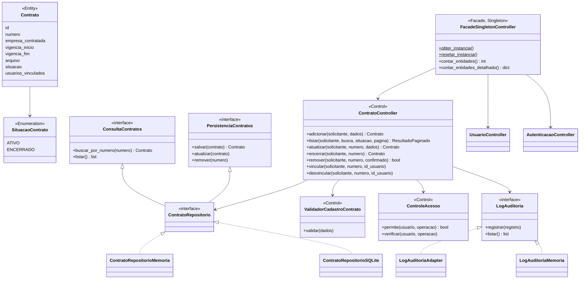

# 08 · Projeto

## 1. Divisão de pacotes

```
src/
├── fronteira/     # Telas de console (usuários, login, painel por perfil, contratos)
├── controle/      # Regras de negócio
│   ├── acesso/    # Controle de acesso por perfil
│   ├── seguranca/ # Hash de senha
│   ├── utils/     # Datas no padrão brasileiro
│   └── validacao/ # Um validador por regra
├── entidade/      # Usuario, Perfil, Acesso, Contrato e Evidencia
├── excecao/       # Exceções de validação, de acesso e de persistência
├── log/           # Log de auditoria (interface, adaptador e versão em memória)
├── persistencia/  # Repositórios (interface, memória e SQLite)
└── main.py        # Raiz de composição
```

**Regra de dependência:** `fronteira` → `controle` → `entidade`; `controle` depende da **interface** do repositório, nunca de uma implementação. Só o `main.py` conhece as implementações concretas e as injeta.

## 2. Diagrama de classes de projeto



O diagrama mostra as camadas, os validadores com as exceções que cada um lança, a hierarquia de exceções de validação e os dois mecanismos de persistência com as exceções de armazenamento.

As duas partes que mais importam estão também abaixo, para leitura no GitHub.

### Exceções de validação e de persistência

```mermaid
classDiagram
    Exception <|-- ValidacaoError
    Exception <|-- PersistenciaError
    ValidacaoError <|-- CampoObrigatorioError
    ValidacaoError <|-- CpfInvalidoError
    ValidacaoError <|-- EmailInvalidoError
    ValidacaoError <|-- PerfilInvalidoError
    ValidacaoError <|-- UsuarioDuplicadoError
    ValidacaoError <|-- NomeMuitoLongoError
    ValidacaoError <|-- TermosNaoAceitosError
    ValidacaoError <|-- ContratoNumeroJaCadastradoError
    ValidacaoError <|-- ContratoNaoEncontradoError
    ValidacaoError <|-- ContratoComEvidenciasError
    ValidacaoError <|-- VigenciaInvalidaError
    ValidacaoError <|-- DataInvalidaError
    ValidacaoError <|-- ArquivoInvalidoError
    ValidacaoError <|-- PerfilNaoVinculavelError
    ValidacaoError <|-- UltimoFiscalError
    Exception <|-- AcessoNegadoError
    ValidacaoError <|-- LoginInvalidoError
    ValidacaoError <|-- SenhaInvalidaError
    LoginInvalidoError <|-- LoginVazioError
    LoginInvalidoError <|-- LoginMuitoLongoError
    LoginInvalidoError <|-- LoginComNumerosError
    SenhaInvalidaError <|-- SenhaMuitoCurtaError
    SenhaInvalidaError <|-- SenhaMuitoLongaError
    SenhaInvalidaError <|-- SenhaComPoucosTiposError
    SenhaInvalidaError <|-- SenhaIgualLoginError
    SenhaInvalidaError <|-- SenhasDiferentesError
    PersistenciaError <|-- ConexaoPersistenciaError
    PersistenciaError <|-- LeituraPersistenciaError
    PersistenciaError <|-- EscritaPersistenciaError
```



A fronteira captura `ValidacaoError` e `PersistenciaError` e mostra a mensagem sem encerrar o programa.

### Os dois mecanismos de persistência



A escolha do mecanismo está registrada no [ADR 0001](adr/0001-persistencia-substituivel.md).

### Contratos, log de auditoria e fachada



A mesma estrutura, em Mermaid, para leitura direta no GitHub:



A fachada concentra o acesso da fronteira aos controllers ([ADR 0002](adr/0002-fachada-unica.md)). A permissão é conferida nos controllers, e o log de auditoria só aceita acrescentar e consultar registros.

## 3. Padrões e princípios usados

Tabela preenchida a cada sprint, conforme os padrões entram no código.

| Padrão / princípio | Onde | Para quê |
|--------------------|------|----------|
| Segregação de interfaces (ISP) | `ConsultaUsuarios` e `PersistenciaUsuarios` | Quem só consulta não depende de gravação |
| Inversão de dependência (DIP) | `UsuarioController` → `UsuarioRepositorio` | Trocar o mecanismo sem mexer na regra de negócio |
| Raiz de composição | `main.py` | Único lugar que escolhe as implementações |
| Uma regra por classe | `Validador` e seus filhos | Incluir ou mudar uma regra sem tocar nas outras |
| DTO | `DadosCadastroUsuario` e `DadosCadastroContrato` | Levar os dados da fronteira ao controle |
| Facade (GoF) | `FacadeSingletonController` | Ponto único de acesso da fronteira aos controllers |
| Singleton (GoF) | `FacadeSingletonController` | Uma só instância da fachada em toda a aplicação |
| Adapter (GoF) | `LogAuditoriaAdapter` | Isolar a biblioteca `logging` atrás da interface `LogAuditoria` |

Os demais padrões GoF (Repository, Factory, Template Method, Command e Memento) entram nesta tabela nas sprints em que forem implementados.
