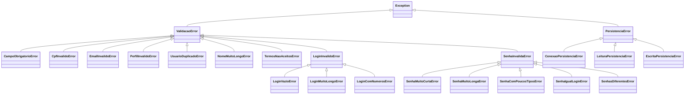
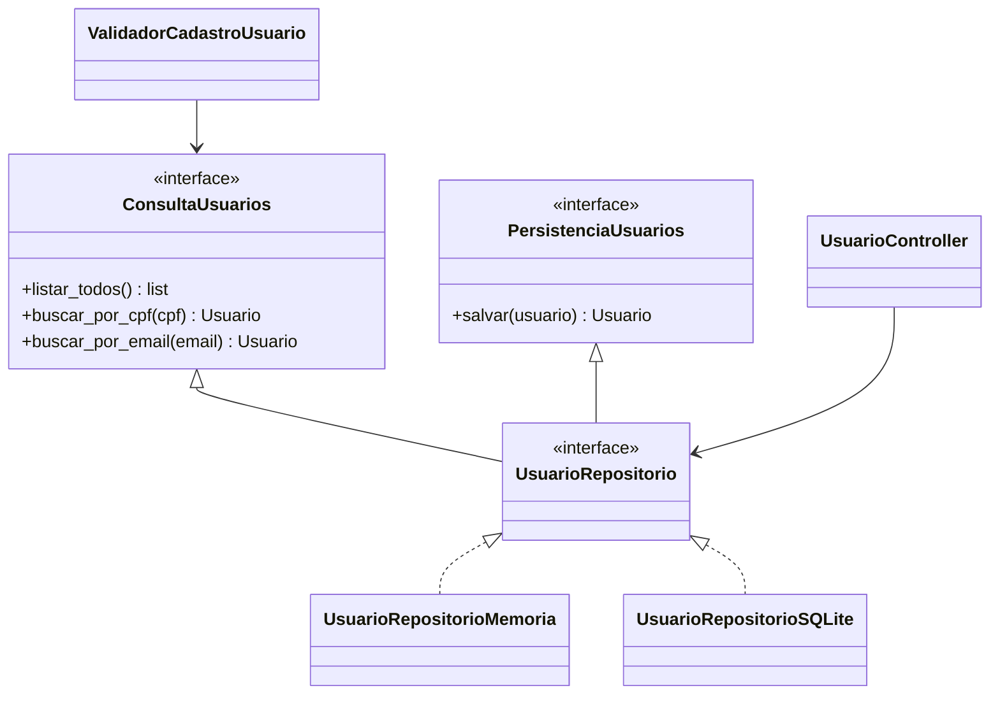

# 08 · Projeto

## 1. Divisão de pacotes

```
src/
├── fronteira/     # Telas de console (UsuarioFronteira)
├── controle/      # Regras de negócio
│   └── validacao/ # Um validador por regra
├── entidade/      # Usuario e Perfil
├── excecao/       # Exceções de validação e de persistência
├── persistencia/  # Repositórios (interface, memória e SQLite)
└── main.py        # Raiz de composição
```

**Regra de dependência:** `fronteira` → `controle` → `entidade`; `controle` depende da **interface** do repositório, nunca de uma implementação. Só o `main.py` conhece as implementações concretas e as injeta.

## 2. Diagrama de classes de projeto

Diagrama editável: [`classes-projeto-usuarios.drawio`](diagramas/classes-projeto-usuarios.drawio) (abra no [diagrams.net](https://app.diagrams.net) ou na extensão Draw.io do VS Code). Ele mostra as camadas, os validadores com as exceções que cada um lança, a hierarquia de exceções de validação e os dois mecanismos de persistência com as exceções de armazenamento.

As duas partes que mais importam estão também abaixo, para leitura no GitHub.

### Exceções de validação e de persistência



A fronteira captura `ValidacaoError` e `PersistenciaError` e mostra a mensagem sem encerrar o programa.

### Os dois mecanismos de persistência



A escolha do mecanismo está registrada no [ADR 0001](adr/0001-persistencia-substituivel.md).

## 3. Padrões e princípios usados

Tabela preenchida a cada sprint, conforme os padrões entram no código.

| Padrão / princípio | Onde | Para quê |
|--------------------|------|----------|
| Segregação de interfaces (ISP) | `ConsultaUsuarios` e `PersistenciaUsuarios` | Quem só consulta não depende de gravação |
| Inversão de dependência (DIP) | `UsuarioController` → `UsuarioRepositorio` | Trocar o mecanismo sem mexer na regra de negócio |
| Raiz de composição | `main.py` | Único lugar que escolhe as implementações |
| Uma regra por classe | `Validador` e seus filhos | Incluir ou mudar uma regra sem tocar nas outras |
| DTO | `DadosCadastroUsuario` | Levar os dados da fronteira ao controle |

Os padrões GoF (Facade, Singleton, Repository, Factory, Adapter, Template Method, Command e Memento) entram nesta tabela nas sprints em que forem implementados.
